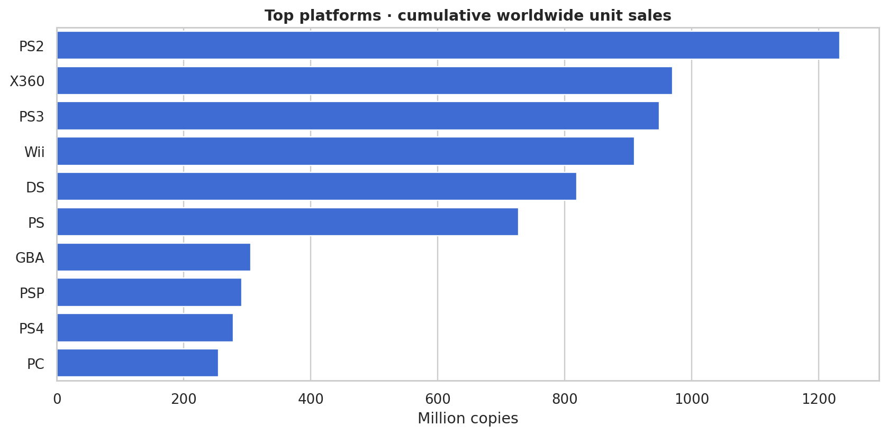
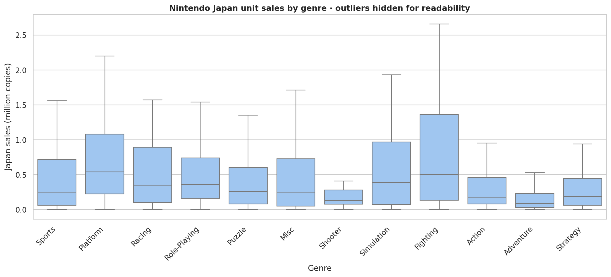
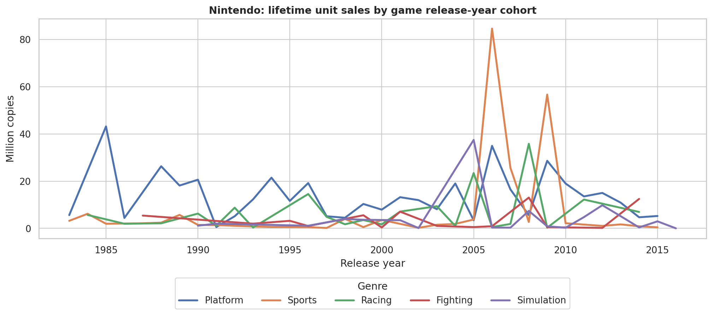

# 🎮 Video Game Sales Analytics

**An end-to-end exploratory data analysis and interactive market intelligence dashboard** built with Python, pandas, seaborn, Plotly, Streamlit, and SQL.

> **Scope:** Historical video-game sales data. Each record is a *game-platform entry*, not a unique game title. Sales measure estimated **millions of copies** (not revenue). A release-year trend groups accumulated lifetime sales by a game's release year; it does not measure transactions occurring in that year.

## Project overview

| | |
|---|---|
| **Business question** | Which historical platforms, publishers, genres and regions dominated the recorded video-game market? |
| **Data** | Gregory Smith's historic VGSales sample (~16,598 source records; games with >100,000 copies sold) |
| **Deliverables** | Interactive dashboard, reproducible notebook, SQL queries, auto-generated findings, plots, tests |
| **Portfolio skills** | Cleaning, quality validation, groupby, distributions, quartiles/IQR, time-cohort analysis, segment analysis, SQL, data storytelling |

## Quick start

Requires **Python 3.10+**. **The downloadable ZIP prepared for the dataset owner includes their `data/games.csv`, so no dataset download is required for local use.** If cloning only the code from GitHub, add a copy of the source CSV to `data/games.csv` (the CSV is ignored by Git) or run the download script.

```bash
# 1. Create an environment (recommended)
python -m venv .venv

# macOS/Linux:
source .venv/bin/activate
# Windows PowerShell:
# .venv\Scripts\Activate.ps1

# 2. Install dependencies
pip install -r requirements.txt

# 3. Confirm the supplied data is in data/games.csv
# (for a GitHub clone without the CSV, run: python scripts/download_data.py)

# 4. Launch the dashboard
streamlit run app.py
```

If you cloned the code-only repository without the CSV, manually download [games.csv from the course link](https://disk.360.yandex.ru/i/eQEYbmT4YSCUHQ) or [vgsales.csv from Zenodo](https://zenodo.org/records/5898311), save it as **`data/games.csv`**, and skip step 3. The Streamlit app also supports drag-and-drop CSV upload in its sidebar.

### Additional commands

```bash
jupyter lab notebooks/01_eda.ipynb      # EDA notebook
python scripts/generate_report.py       # Data-driven reports/insights.md + figures
python scripts/run_sql_analysis.py      # Execute SQLite queries + Markdown results
python -m pytest -q                     # Automated tests
```


## Verified results from supplied `games.csv`

These figures were calculated directly from the supplied dataset (the generated report has more detail):

| Metric | Observed result |
| --- | ---: |
| Raw game-platform entries | 16,598 |
| Complete, valid entries after cleaning | 16,291 |
| Rows removed | 307 |
| Cumulative worldwide sales of observed entries | 8,811.97 million copies |
| Leading platform by cumulative worldwide units | PS2 (1,233.46 million) |
| Leading publisher by cumulative worldwide units | Nintendo (1,784.43 million) |
| Leading release-year cohort by cumulative lifetime units | 2008 (678.90 million) |
| Highest Nintendo regional median per record | North America (0.375 million) |
| Largest Nintendo Japan genre IQR | Fighting (1.2325 million) |
| Nintendo Sports strongest release-year cohorts | 2006 (84.62M) and 2009 (56.67M) |

The dataset's `Year` indicates **release year**; these are not yearly transaction sales.

### Portfolio figures







Read the full measured case study at [`reports/insights.md`](reports/insights.md).

## Dashboard walkthrough

The application has five connected views:

1. **Overview:** KPIs, the strongest platforms/genres/publishers, top-selling game-platform records.
2. **Release-year trends:** cumulative sales for games released in each year, split into genre/platform/publisher cohorts; release counts.
3. **Regional markets:** North America, Europe, Japan, other regions; share of regional sales; platform-by-genre heatmap.
4. **Nintendo deep dive:** regional medians, Japanese distribution boxplots and IQR, Sports genre's top release-year cohorts.
5. **Data & methods:** audit findings, disclosure of assumptions and limitations, downloadable filtered table.

The sidebar filters by **release years, region, platforms, genres, and publishers**. All business metrics are recalculated from the actual local dataset; no analytic claims are hard-coded into the app.

## Repository structure

```text
video-game-sales-analytics/
├── app.py                         # Interactive Streamlit dashboard
├── data/                          # User-supplied CSV is local (Git-ignored)
│   ├── games.csv                  # Available in personal ZIP, not in GitHub commit
│   └── README.md
├── notebooks/
│   └── 01_eda.ipynb               # Reproducible step-by-step EDA
├── src/
│   ├── data.py                     # Validation, cleaning, data-quality audit
│   ├── analysis.py                 # Reusable analytics functions
│   └── charts.py                   # Plotly chart templates
├── sql/
│   └── analysis.sql                # SQLite analytic queries
├── scripts/
│   ├── download_data.py           # Acquire and validate CSV
│   ├── generate_report.py         # Build measured insights + PNG figures
│   └── run_sql_analysis.py        # Run SQL and export results
├── reports/
│   └── README.md                   # How to generate research deliverables
├── tests/                          # Offline tests using labeled synthetic fixtures
├── .streamlit/config.toml         # Dark design theme
├── requirements.txt
└── START_HERE_RU.md               # Russian setup instructions
```

## Research methodology

**1. Ingest and validate.** Verify required schema and numeric fields; inspect data types, null counts, duplicates and sales value plausibility. Explicitly preserve the original raw file.

**2. Clean conservatively.** Remove incomplete observations rather than guessing Year or Publisher, trim text fields, reject negative sales, ensure valid integers for rank/year and remove exact duplicates. Keep the dataset's reported release years instead of inventing corrections.

**3. Measure.** Distinguish number of game-platform releases from summed lifetime units; compare mean vs median; estimate interquartile range, `Q3 − Q1`, to describe skewed Japanese genre sales.

**4. Segment.** Filter by year, platform, genre, publisher and regional sales metric. Do regional comparisons using medians **within a region**, excluding worldwide aggregate from the regional choice.

**5. Communicate.** Describe the ranking and cohort views with precise units and sample limitations. Export replicable findings using `python scripts/generate_report.py`.

## SQL analysis

`sql/analysis.sql` demonstrates `GROUP BY`, aggregation, `ORDER BY`, `LIMIT`, CTEs and conditional filtering in SQLite. Results are created from the same cleaned data as the dashboard, preventing mismatches between Python and SQL.

## Important limitations

- **Selection bias:** the VGSales sample is not a full census of video games; it covers games that cleared a sales threshold.
- **Vintage data:** the original set is historical and is unsuitable for describing the current 2026 market.
- **Cohort vs annual sales:** the dataset does not contain yearly transaction dates. `Year` is a release date, while `Global_Sales` is an accumulated sales figure. Lines against `Year` are release-cohort analyses.
- **Units:** sales columns are in **millions of copies**, not million dollars or revenue.
- **Observational unit:** games on multiple platforms appear multiple times; counts of rows are not counts of distinct titles.
- **Rounding and accuracy:** estimated regional sales can differ slightly from worldwide totals; zeros may be rounded values. Findings are descriptive, not causal.
- **Missingness:** dropping incomplete rows may change the represented sample. Inspect `quality_report` to see how much.

## Source & attribution

- Gregory Smith, **Video Games Sales**, archival Zenodo record: https://zenodo.org/records/5898311 (DOI: 10.5281/zenodo.5898311).
- Original Kaggle listing: https://www.kaggle.com/datasets/gregorut/videogamesales
- Source originally gathered from the VGChartz site as described by the dataset authors.
- Course mirror supplied with exercise: https://disk.360.yandex.ru/i/eQEYbmT4YSCUHQ

**Dataset distribution:** the private downloadable project ZIP for this user contains the CSV they personally supplied. The file is excluded by `.gitignore` when publishing the code to GitHub. This README and the full SQL/notebook outputs reflect the exact supplied file. Repository software is licensed under MIT; dataset rights are governed separately by its source. Check redistribution permission before publishing the raw CSV publicly.

## Potential next steps

- Add PostgreSQL plus a dbt semantic layer.
- Write a reproducible CI workflow that runs tests on pull requests.
- Build a documented cohort comparison study and a concise executive presentation.

---

### CV / resume snippet

> **Video Game Sales Analytics | Python, pandas, SQL, Plotly, Streamlit** — Built a reproducible EDA pipeline and interactive dashboard for a historical dataset of ~16K game-platform records; cleaned and validated data, analyzed geographic and genre patterns, compared publisher/platform performance, and documented selection bias and release-year cohort limitations.
