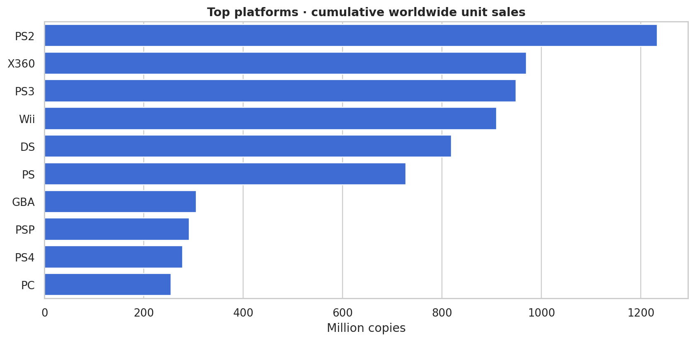
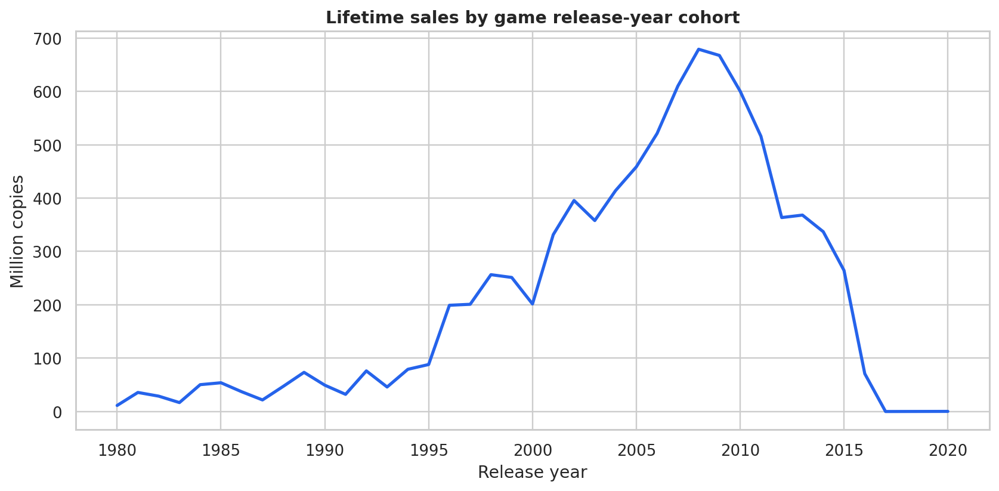
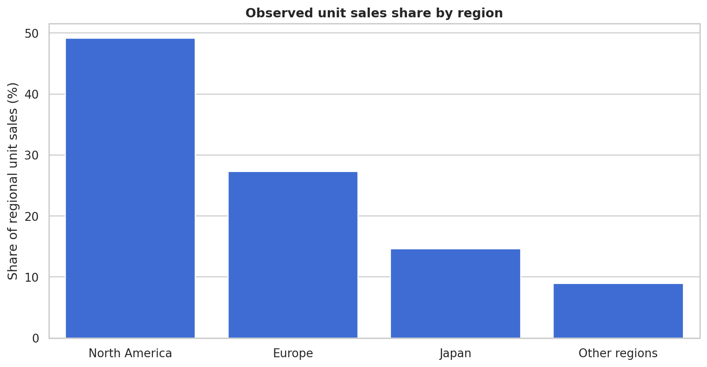
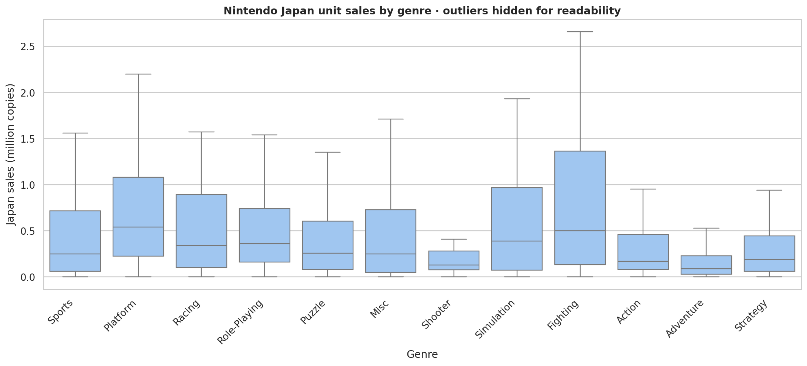
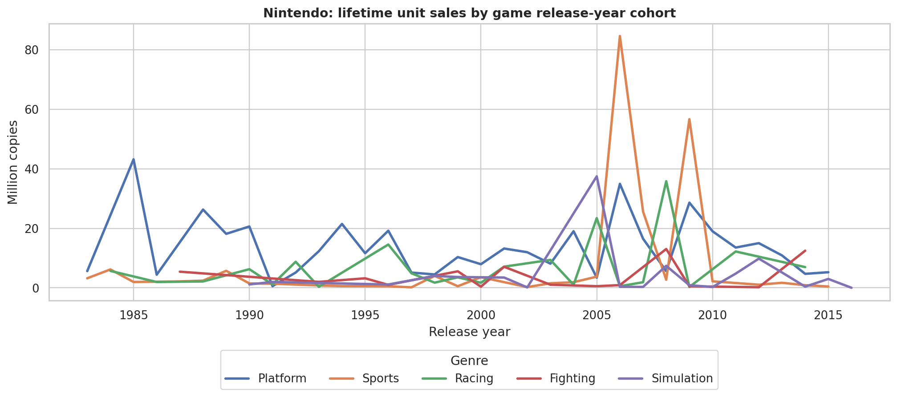

# Video Game Sales — Analytical Findings

> Auto-generated from `games.csv` by `python scripts/generate_report.py`. All displayed results are calculated from the file at runtime.

## Executive summary

- **16,291** valid game-platform observations from **16,598** source rows. **307** rows removed during cleaning.
- **8,811.97 million** cumulative worldwide copies across observations (dataset estimate).
- Leading platform by *cumulative worldwide copies*: **PS2** (1,233.46 million).
- Leading publisher by *cumulative worldwide copies*: **Nintendo** (1,784.43 million).
- Release-year cohort with greatest accumulated unit sales: **2008** (678.90 million).
- **696** Nintendo-published game-platform records in the cleaned dataset.

## 1. Data quality

| Metric | Result |
| --- | ---: |
| Raw rows | 16,598 |
| Clean rows | 16,291 |
| Removed rows | 307 |
| Missing Year in raw source | 271 |
| Missing Publisher in raw source | 58 |
| Duplicate source rows | 0 |
| Maximum regional sum vs worldwide absolute discrepancy | 0.020 million |

We remove missing or invalid observations rather than invent release years or publishers. Regional/worldwide fields are rounded in the original data.

## 2. Historical platform performance

| Platform | sales_m | releases |
| --- | --- | --- |
| PS2 | 1233.46 | 2127 |
| X360 | 969.60 | 1234 |
| PS3 | 949.35 | 1304 |
| Wii | 909.81 | 1290 |
| DS | 818.91 | 2131 |
| PS | 727.39 | 1189 |
| GBA | 305.62 | 786 |
| PSP | 291.71 | 1197 |
| PS4 | 278.10 | 336 |
| PC | 254.70 | 938 |



## 3. Release-year cohorts

The most commercially successful release cohort, measured by lifetime copies of games **released that year**, is 2008. This is not an estimate of sales that occurred in that calendar year.



## 4. Regional distribution

| region | sales_m | share_pct |
| --- | --- | --- |
| North America | 4327.65 | 49.14 |
| Europe | 2406.69 | 27.33 |
| Japan | 1284.27 | 14.58 |
| Other regions | 788.91 | 8.96 |



These percentages divide the sum of the four regional sales estimates; rounding may cause small differences from `Global_Sales`.

## 5. Nintendo: Japan, genre, and release cohorts

Highest Nintendo **regional median sales per record** (not sum): **North America**, 0.375 million copies.

| region | median_m |
| --- | --- |
| North America | 0.38 |
| Japan | 0.28 |
| Europe | 0.12 |
| Other regions | 0.03 |

Japan unit sales by genre, including the interquartile range (IQR):

| Genre | count | mean | median | iqr |
| --- | --- | --- | --- | --- |
| Fighting | 18 | 0.83 | 0.50 | 1.23 |
| Simulation | 28 | 0.84 | 0.39 | 0.90 |
| Platform | 111 | 0.92 | 0.54 | 0.86 |
| Racing | 37 | 0.79 | 0.34 | 0.79 |
| Misc | 100 | 0.55 | 0.25 | 0.68 |
| Sports | 55 | 0.65 | 0.25 | 0.66 |
| Role-Playing | 105 | 0.97 | 0.36 | 0.58 |
| Puzzle | 74 | 0.50 | 0.26 | 0.52 |
| Strategy | 31 | 0.34 | 0.19 | 0.39 |
| Action | 78 | 0.37 | 0.17 | 0.38 |
| Shooter | 24 | 0.25 | 0.13 | 0.21 |
| Adventure | 35 | 0.26 | 0.09 | 0.20 |



Five Nintendo genres over release-year cohorts (cumulative lifetime copies of games **released** in each year):



Nintendo Sports release-year cohorts with highest lifetime worldwide unit sales:

| Year | Global sales (M) |
| --- | --- |
| 2006 | 84.62 |
| 2009 | 56.67 |
| 2007 | 25.63 |
| 1984 | 6.18 |
| 1989 | 5.72 |
| 1998 | 4.01 |
| 2005 | 3.75 |

## 6. Responsible interpretation

1. **Selection bias:** source includes only games exceeding roughly 100,000 copies; less successful releases are not represented.
2. **Temporal interpretation:** sales are associated with each game's release year, but are accumulated over its lifetime up to the dataset capture, not annual transaction-level sales.
3. **Sample coverage:** observations are game-platform pairs. Never interpret them as unique game titles without deduplicating `Name`.
4. **Measurement:** `*_Sales` means *million units/copies*, **not revenue** or US dollars.
5. **Age of data:** suitable for historical study, not for 2026 market forecasts.
6. **Outliers and skew:** mean and median may differ; IQR and boxplots help compare distributions.
7. **Rounding:** small discrepancies between regional and worldwide sums are expected.

## Reproduce

```bash
python scripts/download_data.py
python scripts/generate_report.py
streamlit run app.py
```

Dataset: Gregory Smith (2016), archival copy at https://zenodo.org/records/5898311 .
